---

**BUILD WITH INTENTION. SHIP WITH CARE. KEEP GETTING BETTER.**

## 01 / THE DEVELOPER

I'm **Alpha Mugisha** — a Year 2 Software Engineering student at Coding Academy, Rwanda.

I like working where software meets real-world problems: backend systems, database-driven platforms, web experiences, and embedded electronics. I learn by building, testing, breaking things, understanding why, and improving the result.

- **Currently exploring** — backend architecture, full-stack development, databases and applied AI.
- **Also building with** — ESP32, Raspberry Pi, sensors and automation.
- **Engineering mindset** — useful features, clean logic, reliable data, accessible interfaces.
- **Long-term direction** — become an engineer who can take an idea from its first sketch to a dependable product.

---

## 02 / SELECTED WORK

A selection of projects and systems from my portfolio and development work.

<table>
<tr>
<td width="50%" valign="top">

### 01 — RwaSport
**Sports technology · Platform**

A digital platform concept bringing federations, clubs, schools, fixtures and results into one structured system.

React · TypeScript · Express · Prisma · PostgreSQL

43 data models · 13 seeded teams · 37 fixtures

<a href="https://github.com/couper117/platform">Explore project ↗</a>

</td>
<td width="50%" valign="top">

### 02 — Tembera
**Tourism · Web platform**

A structured Rwanda tourism guide with searchable places, maps, categories and saved destinations.

Next.js · TypeScript · Prisma · PostgreSQL

495 places · 30 cities · 87 categories

<a href="https://alphamugisha.vercel.app">View portfolio ↗</a>

</td>
</tr>
<tr>
<td width="50%" valign="top">

### 03 — Greenhouse Automation
**IoT · Embedded systems**

An ESP32-based monitoring and automation prototype connecting environmental sensors, a display, relay control and cloud records.

ESP32 · C++ · Arduino · DHT sensor · Supabase

</td>
<td width="50%" valign="top">

### 04 — Clean Kigali
**Civic technology · Web**

A community sanitation reporting service with issue tracking, multilingual support and an administrative workflow.

TypeScript · Node.js · Express · MySQL

<a href="https://github.com/AlphaMugisha/umuganda">Explore project ↗</a>

</td>
</tr>
<tr>
<td width="50%" valign="top">

### 05 — TransitEco
**Transport · API design**

A transport system prototype for routes, schedules, seat bookings and vehicle-location workflows.

Laravel · PHP · Next.js · TypeScript · REST

<a href="https://github.com/AlphaMugisha/Tega-Bus">Explore project ↗</a>

</td>
<td width="50%" valign="top">

### 06 — Digital Ikibina
**FinTech · Community systems**

A digital approach to rotating savings groups, modelling members, contributions and payout cycles.

Next.js · TypeScript · Prisma · PostgreSQL

<a href="https://github.com/AlphaMugisha/digital-ikibina">Explore project ↗</a>

</td>
</tr>
<tr>
<td width="50%" valign="top">

### 07 — Payment System
**Backend · FinTech**

A multi-role payments application exploring transaction workflows, provider webhooks and background processing.

Next.js · TypeScript · Prisma · PostgreSQL

<a href="https://github.com/AlphaMugisha/payment-system">Explore project ↗</a>

</td>
<td width="50%" valign="top">

### 08 — School & Community Systems
**Full-stack · Practical software**

A collection of systems for institutions and small organisations, including school, library, church and point-of-sale workflows.

PHP · MySQL · JavaScript · Tailwind CSS

<a href="https://github.com/AlphaMugisha/kami">Explore project ↗</a>

</td>
</tr>
</table>

<strong>More things I've been building and exploring</strong>

- **StudyFlow** — student timetable, study activity and dashboard workflows.
- **Reaedify** — an AI-assisted learning app concept for document summaries, exam topics and quizzes.
- **RFID Attendance & Pickup** — ESP32 card-scanning workflows connected to student records.
- **Smart Parking** — Raspberry Pi 5 and sensor-based parking prototype.
- **Cash Power Monitoring** — ESP32 electricity readings sent to a Python/Flask service.
- **Online Alarm System** — browser-based time alerts and scheduling.
- **Booking System** — appointment and reservation workflows.
- **Student Management System** — student records and academic data.

---

## 03 / TOOLBOX

**LANGUAGES**

**WEB & APPLICATION DEVELOPMENT**

**DATA & DEVELOPER TOOLS**

**EMBEDDED & HARDWARE**

---

## 04 / GITHUB ACTIVITY

 

 

### Contribution graph

---

## 05 / WHAT'S NEXT

| Direction | Current focus |
|:--|:--|
| Backend engineering | APIs, server-side architecture and authentication |
| Database engineering | SQL, data modelling, relationships and PostgreSQL |
| Full-stack development | TypeScript, React and Next.js |
| Embedded systems | Microcontrollers, sensors and automation |
| Software quality | Maintainable code, testing and documentation |
| Product building | Deployment, usability and real-world problem solving |

---

## 06 / THE MISSION

> Build useful technology. Understand the systems behind it. Make the next version better.

My mission is to keep developing the skills to design, build and maintain dependable software — especially products that solve practical problems in Rwanda and beyond.

ALPHA MUGISHA · SOFTWARE ENGINEERING · RWANDA

